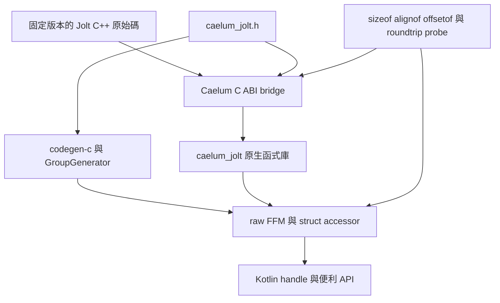

# caelum-jolt 模組開發 Roadmap

建立日期：2026-10-24。更新：首版程式已編寫，僅完成編譯與小範圍契約檢查；原生執行及發佈驗收尚未完成。

`caelum-jolt` 的目標是提供符合 Caelum 記憶體模型的 Kotlin Jolt Physics binding：資料以 `NStruct`、`NValue`、`NPointer`、`NArray` 存取；有生命週期的物件使用具型別的 handle；模擬、查詢與回呼透過明確的原生邊界執行。本文中的 caelum-vk 指本倉庫的 **`caelum-vulkan`，目錄為 `vulkan/`**。

建議採用 **Jolt C++ → 自有 C ABI bridge → Caelum FFM binding → Kotlin 物件 API**。借鑑 Vulkan 的 struct、handle、生成器分層，以及 jolt-jni 的功能分組、所有權語義與使用範例。首個版本先完成可獨立使用的剛體模擬，再擴充角色、約束、車輛等功能。

本文保留最初 roadmap 的設計與階段驗收標準。後續實作已加入 `jolt/`；目前 API 以 [模組 README](../jolt/README.md)、[surface 清單](../jolt/SURFACE.md) 與 header 為準。依本輪「先編寫，暫不做實際測試，可做小範圍測試」的要求，原生模擬、壓力、效能與跨平台驗收延期。下方里程碑勾選框仍代表完整階段驗收，不因程式已寫入而自動勾選。

| 實作狀態 | 已加入內容 | 驗證邊界 |
| --- | --- | --- |
| P0–P2 | 固定來源與 flags、C bridge/handshake、12 個 transport structs、完整 layout/constant oracle、defaults/allocation DSL | generation、Kotlin 編譯、bridge 語法、來源清單與純契約檢查；native oracle 尚未執行 |
| P3–P4 | managed lifetime、shapes、bodies/locks、ray/batch、thread pool、callback registration/exception/deferred queue | 測試與範例已編譯；物理與 worker callback 執行待驗收 |
| P5 | module/BOM、portable publication wiring、licenses/source packaging、benchmark、artifact checker、獨立 Maven consumer | 三平台 linking/runtime、artifact 審核、consumer 與效能數據待執行 |
| P6 | 維持後續範圍 | 本輪不實作 |

詳見 [驗收記錄](../jolt/acceptance/README.md)。此狀態不代表已可發佈 portable release。

## 參考基線

| 來源 | 固定版本 | 用途 |
| --- | --- | --- |
| 本倉庫 Caelum | `3fce449b6d3a19c25832f8cd124100d59e9fcf82` | Vulkan、core、struct、生成器、native 打包慣例 |
| [stephengold/jolt-jni][jni-tree] | `ec8dd7bc8bfefd37b0d62f4ab5d6b9f9e227a6a1`；`jjVersion = 6.2.1-SNAPSHOT` | JVM API、所有權、回呼與 HelloWorld 參考 |
| [jolt-jni 使用的 Jolt fork][fork-tree] | `stephengold/JoltPhysics`，`sg261013`，commit `a4b24c3fadd7eade0435f27e9d6a07564273eb5f` | 辨識 JNI 參考 API 的來源差異 |
| [官方 Jolt Physics][jolt-tree] | `v5.6.0`，commit `e77f175595e64cb44218cc9d9d56fc365ad0e36a` | 建議的首版引擎基線、C++ 語義與 ABI 驗證依據 |

jolt-jni 的版本號與其引擎來源是兩件事；其 [Gradle properties][jni-properties] 明確指定作者 fork。Caelum 預設採官方 Jolt，P0 必須逐項記錄 fork 專屬 API、可對應的官方 API 與延期項目，不能把 jolt-jni 的全部 surface 當成官方 v5.6.0 已有功能。

## 從現有設計沿用什麼

### Caelum Vulkan 與 struct

| 現有設計與來源 | caelum-jolt 的採用方式 |
| --- | --- |
| [`NStruct.Impl` 與 layout padding](../core/src/main/kotlin/net/echonolix/caelum/Type.kt) | bridge 的 C 資料結構由同一套 layout 與欄位 accessor 模型表示；每個 layout 與原生 probe 比對 |
| [`NValue`](../core/src/main/kotlin/net/echonolix/caelum/Value.kt)、[`NPointer`](../core/src/main/kotlin/net/echonolix/caelum/Pointer.kt)、[`NArray`](../core/src/main/kotlin/net/echonolix/caelum/Array.kt) | 型別物件描述 layout，實例是原生記憶體 view；沿用 scalar、nested struct、連續陣列存取 |
| [`GroupGenerator`](../codegen-api/src/main/kotlin/net/echonolix/caelum/codegen/api/generator/GroupGenerator.kt) | 沿用 type object、VarHandle、欄位 offset 與 `NValue<T>`／`NPointer<T>` extension accessor 的生成方式 |
| [`VkStruct`](../vulkan/src/enums/kotlin/net/echonolix/caelum/vulkan/structs/VkStruct.kt) | 沿用 `allocate(scope) { ... }` 與「配置後即有合法預設值」的 API 方向；Jolt 自訂初始化規則 |
| [`GenerateGroupTask`](../vulkan/codegen/src/main/kotlin/net/echonolix/caelum/vulkan/tasks/GenerateGroupTask.kt) | 借鑑 pointer/count 關聯與 array helper；公開 helper 使用 `require` 檢查長度與溢位，不只依靠 JVM assertions |
| [`GenerateHandleTask`](../vulkan/codegen/src/main/kotlin/net/echonolix/caelum/vulkan/tasks/GenerateHandleTask.kt) | 借鑑具型別 handle、parent/container 與物件操作分組；補上 Jolt 所需的 close、retain/release 與借用期限 |
| [`VkFunction`](../vulkan/src/baseSrc/kotlin/net/echonolix/caelum/vulkan/functions/VkFunction.kt)、`NFunction` | 沿用函式 descriptor 與 FFM upcall 概念；callback stub 的所有權改為明確的 registration/world 範圍 |
| [`vulkan/build.gradle.kts`](../vulkan/build.gradle.kts) | 借鑑生成物與手寫層分離；初期使用一般 source set，不預先複製八份 enums/groups 的編譯分片 |

不沿用 Vulkan 專屬的 `sType`、`pNext`、instance/device proc-address 查找與 XML registry pipeline。Jolt 只需要載入自己的 bridge 與解析固定 exports，沒有理由模擬 Vulkan dispatch table。

`caelum-struct` 是另一條生成路徑：[`StructCodegenProcessor`](../struct/src/main/kotlin/net/echonolix/caelum/struct/StructCodegenProcessor.kt) 掃描已編譯的 Kotlin interface，再透過 [`StructElementResolver`](../struct/src/main/kotlin/net/echonolix/caelum/struct/StructElementResolver.kt) 生成 layout。它不會推導 Jolt C++ 類別布局，也不能取代 C ABI 驗證。首版以 bridge header 為 ABI 的單一來源，使用 `codegen-c`；不另外手寫一份同名 Kotlin struct schema。`caelum-struct` 可留給下游自訂的應用資料。

### jolt-jni

| 已觀察到的設計 | 借鑑與調整 |
| --- | --- |
| [README][jni-readme] 保持與 Jolt 類別／方法的對應，另有 `Const*` 介面 | 保留 PhysicsSystem、BodyInterface、Shape、Constraint 等概念；Kotlin 層用唯讀 view 區分可寫能力 |
| [`JoltPhysicsObject`][jni-object] 管理原生地址、freeing action、containing object，實作 `AutoCloseable` 並提供可選 Cleaner | 明確區分 owned、borrowed、ref-counted；公開 API 的關閉檢查必須在未啟用 assertions 時也有效 |
| [`ShapeRefC`][jni-shape-ref] 對應 `RefConst<Shape>` | shape 的取得、retain、借用與 release 各有明確語義；不能把所有 handle 都當成 `delete` |
| [`PhysicsSystem`][jni-system] 保存 body/query interface 與 filter/listener 引用 | 子 view 保留 world owner；保持 callback 強引用，並防止 owner 關閉後仍使用 native address |
| [`Vec3`][jni-vec3] 為 Java float 欄位、[`RVec3`][jni-rvec3] 為 double 欄位 | 借鑑語義上的方向／速度與世界座標分離；Caelum 的熱路徑提供原生 struct 與可重用 out parameter |
| [`CustomContactListener` 的 C++ glue][jni-contact] 轉接虛函式並處理 JNI 執行緒與全域引用 | 重新實作為 C function pointer + context，再用 FFM upcall；不複製 JNI glue |
| [HelloWorld][jni-hello] 展示初始化、filter、shape、body、update 與銷毀 | 作為首個 headless 驗收場景；依 Caelum 所有權規則補齊資源清理 |

jolt-jni 是設計與行為參考，不加入 `caelum-jolt` 的 runtime 依賴，也不承諾 Java API 原樣相容。若後續移植其程式碼或範例，保留 MIT copyright/license；同樣保留 Jolt 的授權與 provenance。

## 原生邊界與生成策略



### 選擇自有 C bridge

[`codegen-cpp`](../codegen-cpp/README.md) 已能生成部分 C++ opaque class、建構／解構與基本參數的 shim，但目前不支援 references、arrays、templates、record value、inheritance、callbacks 或推導所有權。Jolt 大量使用這些特性，因此「直接把 Jolt headers 交給現有 C++ generator」不能作為首版路線。

首版維護範圍有限、可審核的 `caelum_jolt.h` 與 C++ bridge，交由 `codegen-c` 生成 Kotlin raw API。bridge 負責 C++ 建構、引用計數、虛函式轉接與資料轉換；Kotlin facade 負責型別、owner state 與方便使用的 overload。後續依重複程度考慮小型生成器，不先擴充成完整通用 C++ binding 系統。

必須遵守 [`BINDING-AUTHORING.md`](../BINDING-AUTHORING.md)：固定輸入、固定寬度型別、每個欄位單獨宣告、完整 symbol/surface 記錄、原生 layout oracle、授權與發佈內容檢查。

### C ABI 契約

1. 只輸出有 `cj_` 前綴的 C symbols。C++ 類別使用 opaque pointer；不把 vtable、`std::vector`、`JPH::Ref` 或 SIMD register 暴露給 JVM。
2. 輸入輸出採固定寬度整數與指標；首版 struct 以 pointer 傳遞，結果寫入 out parameter，避免 aggregate-by-value ABI。pointer 的 FFM descriptor/carrier 必須在各 target 驗證，不能因 Vulkan handle 使用 `Long` 就假設所有指標與 ID 都是同一種型別。
3. bridge 的 enum/status 使用明確的 32-bit 值；C++ 原 enum 即使是 `uint8` 也以顯式轉換與有效值檢查處理。布林用固定的 `uint8_t` 0/1。禁止裸 `long`、未確認的 compiler-dependent enum 與 C++ `bool` 直接跨邊界。
4. 建立物件先清空 out pointer；只有成功且非 null 才交付所有權。失敗時由 bridge 清理部分建立的資源，返回 status 與可讀錯誤。shape 建立失敗與 `EPhysicsUpdateError` 的位元資訊必須保留。
5. 不允許 C++ 或 JVM exception 穿越 FFI。P1 固定 exception build policy；若關閉 C++ exceptions，不能把 `catch` 當成可用的錯誤方案，必須逐個處理可回報失敗。OOM、assert 等不可恢復的 native failure 不承諾可轉為 Kotlin exception。
6. 同步錯誤字串在下一次 native call 前複製；worker callback 的錯誤另走 world/registration 的並行安全通道，不能讀取主執行緒的 thread-local error 來代替。
7. 每個 pointer 欄位與參數記錄讀寫方向、count、nullable、是否保留與借用期限。暫時輸入由 native 在返回前讀取／複製；需長期持有的記憶體必須另建 owner。

### 載入與版本握手

`JoltRuntime.load()` 先透過 [`NativeLibraries`](../core/src/main/kotlin/net/echonolix/caelum/NativeLibraries.kt) 載入 `caelum_jolt`，再由小型 bootstrap 檢查 bridge ABI version、Jolt commit/build ID、precision、object-layer bits、CPU feature policy。驗證成功後才初始化會 eager resolve symbols 的 generated raw API。

同一進程只支援一個相容 build。重複載入相同設定可重用；不同 precision 或 ABI 必須明確拒絕。runtime lease 管理 allocator、Factory、RegisterTypes 與最後的 UnregisterTypes；有 world、shape 或其他原生資源存活時不能關閉最後一份 runtime。`close()` 釋放 Jolt 狀態，不承諾卸載由 `System.load` 載入的函式庫。

## Struct 與型別設計

### 區分資料布局與 C++ 物件

| 類別 | 預定型別與表示 | 所有權／配置方式 |
| --- | --- | --- |
| 純數值資料 | `JoltVec3`、`JoltRVec3`、`JoltQuat`，生成為 `NStruct.Impl` type object | `AllocateScope` 配置，透過 `NValue`／`NPointer` 存取 |
| 設定資料 | `JoltBodyCreateInfo`、`JoltPhysicsSystemConfig`、各 shape create-info | bridge 自訂 C struct；有明確初始化函式，呼叫時轉為 C++ settings |
| 查詢與批次資料 | `JoltRayCastResult`、`JoltBodyTransform`、body ID array | caller 提供 output storage；count/capacity 明確，批次結果不逐筆建立 JVM 物件 |
| 無生命週期的識別值 | `JoltBodyId`、`JoltSubShapeId`、`JoltObjectLayer` | 具型別的固定寬度 scalar，不實作 `close()` |
| 引擎資源 | `JoltPhysicsSystem`、`JoltTempAllocator`、`JoltJobSystem` | C++ opaque handle，由 owned wrapper 管理 |
| 引用計數資源 | `JoltShape`，後續的 constraint/material | bridge 的 retain/release；一次取得對應一份引用 |
| 暫時借用物件 | `BodyView`、contact manifold/settings view、body/query interface | owner/lock/callback 限定期限；禁止自行 destroy |

[`JPH::BodyCreationSettings`][jolt-body-settings] 含 `RefConst<ShapeSettings>` 與 `RefConst<Shape>`，不是可以用 `memcpy` 或 `calloc` 建立的普通 C struct。`JoltBodyCreateInfo` 是 Caelum 定義的傳輸資料，不是該 C++ 類別的 layout mirror。它的 shape pointer 僅借用至同步 create call 返回；bridge 在建立成功的 body 中保留需要的 shape 引用。

### Layout 與精度

首版建議固定 **double-precision 世界座標**，`JPH_DOUBLE_PRECISION` 開啟；速度、方向、法線與 quaternion 維持 float。這是提案中的 build policy，不代表所有 Jolt 數學運算都變為 double。[上游 `Real.h`][jolt-real] 會依該旗標切換 `RVec3` 的實際 C++ 型別，不能在載入後偷偷改 Kotlin layout。

bridge 的傳輸布局獨立於 SIMD，以下為待 probe 驗證的目標布局：

| bridge 資料 | 成員 | 目標 size/alignment |
| --- | --- | --- |
| Vec3 | `float x; float y; float z;` | 12 / 4 bytes |
| RVec3 | `double x; double y; double z;` | 24 / 8 bytes |
| Quat | `float x; float y; float z; float w;` | 16 / 4 bytes |

bridge 用欄位值建構 Jolt 的 Vec3/DVec3/Quat，不把上述 buffer reinterpret 成 Jolt 的 SIMD 類別。零拷貝只指 Kotlin accessor 直接存取這份 C 傳輸記憶體；不承諾 bridge 到 Jolt 內部表示也零拷貝。

`BodyID` 保留完整 32-bit 值，包括 index 與 sequence bits；invalid 值由 [上游定義][jolt-body-id] 驗證，不能把 ID 當指標，也不能只保存 index。ID 只在來源 world 有效，有限的 sequence bits 不保證永久唯一；需要長期保存的應用 entity identity 應另行管理。首版 `ObjectLayer` 固定 16-bit，與 [JPH_OBJECT_LAYER_BITS][jolt-object-layer] 相符；其他設定需獨立 build policy 與範圍驗證。

### 初始化與 accessor

raw struct 由 `codegen-c` 生成，公共便利層提供每個設定型別的 `allocate(scope) { ... }`。初期不需要再建立一份 `JoltStruct` layout hierarchy；若要抽出基類，只抽共通初始化契約，不複製 Vulkan 的 `sType/pNext`。

- `allocate()` 必須呼叫 bridge initializer，完整寫入傳輸 struct，再映射官方預設值，例如 identity quaternion、gravity factor、damping。全零記憶體不等於合法的 Jolt settings。
- 陣列配置逐項初始化；nested struct getter 保留 alias/view 語義，明確區分欄位 view 與深複製。
- pointer/count helper 同時設定兩者，檢查同批陣列長度、整數轉換與 size multiplication overflow。借用的陣列不得逃出 scope。
- raw `malloc` 只代表未初始化儲存區；不讓文件範例使用它建立可直接傳給引擎的 settings。
- ABI 型別只生成一份，public package 可以 alias 或提供 extension；避免 raw/public 各維護一份 layout。

現有 [`MemoryStack._calloc`](../core/src/main/java/net/echonolix/caelum/MemoryStack.java) 與 `_malloc` 都只推進配置位置，沒有清零。因而不能僅照搬 `VkStruct.allocate()` 的 `calloc` 呼叫就宣稱已初始化。P2 必須用先填入非零資料、再重用 frame 的場景驗證 initializer，包含 padding、陣列每一項與非零預設值。若需修改 shared core，另列最小修正與既有 binding 回歸範圍。

`NValue`／`NPointer` 保存裸地址，本身不攜帶可檢查的 arena lifetime。對 raw struct 的 scope 規則必須明文保留；managed wrapper 的 use-after-close 檢查不能宣稱連任意逃逸的 raw pointer 都能保護。

目前使用方式如下；完整可編譯範例見 `jolt/src/examples/kotlin/`：

```kotlin
// world 與 shape 由外層 use 管理，createAndAdd 同步讀取 create-info。
val bodyId = MemoryStack {
    val info = JoltBodyCreateInfo.allocate {
        position.set(0.0, 2.0, 0.0)
        motion = JoltMotionType.CJ_DYNAMIC
        layer = movingLayer
    }
    world.bodies.createAndAdd(info, shape)
}
// bodyId 是值，不借用上方 frame；world 保有 body，body 保有 shape 引用。
```

## 所有權與執行緒契約

### 物件生命週期

| 物件 | 契約 |
| --- | --- |
| Runtime | 管理引擎全域狀態；初始化／失敗回復受同步保護，最後釋放必須晚於所有 native resource |
| PhysicsSystem | owned、`AutoCloseable`；持有 filter/listener registration，close 前停止新的操作並等待進行中的 update |
| BodyInterface／Query | borrowed world view；保留 owner，world 關閉即拒絕呼叫；不得刪除 native interface |
| Body | 由 world 管理；使用 ID 存取；remove 與 destroy 分開，銷毀後禁止以舊 ID 操作重用的槽位 |
| Shape | adopt 成功建立所取得的一份引用；retain 明確新增一份，close 最多 release 一次；由 body 持有時關閉應用端 wrapper 不會提早刪除 shape |
| Body lock view | 只能在 `withBodyRead`／`withBodyWrite` 範圍使用；成功 lock 後才交付 view，解鎖後不可保留 |
| TempAllocator／JobSystem | 明確 owned 或由 world 持有；不能在 update 尚未結束時 close，也不能未經定義就供多個 world 並行共用 |

管理層以 `require/check` 或固定例外檢查狀態，不依賴 `assert`。重複 close 必須安全；borrowed view 不提供破壞 owner 的 close。Cleaner 只可作漏釋放提示或保守後備，正常路徑使用 `use` 與明確 teardown。

清理順序為：停止提交操作並等待 update → 卸載可移除的 listener 並確認沒有 callback 在執行 → remove/destroy bodies 與其他 world 資源 → destroy world → 釋放 world 所持有的 filters，以及應用仍持有的 refs、job system、temp allocator → 關閉最後的 runtime。初始化時傳入的 filter 必須至少存活到 world 銷毀，不能假設它與 listener 一樣能提前 unregister。若某資源仍被其他 owner 持有，僅釋放目前 owner 的引用。

### Callback 與多執行緒

先提供 native table/mask filter 與單執行緒 job system，再加入 native thread pool 和自訂 Kotlin listener。這使首個模擬不依賴 callback，後續能分別驗證引擎與跨執行緒橋接。

Jolt [ContactListener 契約][jolt-contact] 明確指出 callback 可能由多個 worker 同時呼叫，而且 body 已鎖定。一般 locking body interface 會造成 deadlock；callback 不得任意更動物理世界。`OnContactRemoved` 甚至不能再存取 body。Caelum 必須提供範圍受限的唯讀參數與 ID，將需要修改世界的操作排到 update 結束後；可寫 contact settings 僅允許在該 callback 當下修改。

native adapter 將 manifold 與 settings 轉為僅在這次 callback 有效的 C 傳輸資料，允許修改的 settings 在返回前寫回 Jolt；不能把 C++ 物件地址直接當成 `NStruct`。需要延後處理的事件須複製必要的 ID／資料，不能把 callback buffer 或 body view 放進佇列。

每份 registration 強持有 Kotlin callback、context 與 `Arena.ofShared()`。沿用 `NFunction` 的 descriptor/handle，但用 registration 所屬 arena 建立 stub；不能直接依賴全域 cache，再透過全域 `freeFunctionStubs()` 關閉單一 world 的 callback。

callback adapter 必須捕捉 JVM `Throwable`，記錄首個失敗與後續錯誤數；有返回值時使用事先定義的安全返回值，例如 validation 拒絕該接觸。待 native 工作返回後，從呼叫端回報錯誤。不得從 callback 關閉自己的 arena、world 或重新進入 update；長時間 update 和可能 upcall 的入口不使用 FFM critical downcall。

## 首版功能範圍

| 功能 | 首版交付 | 後續擴充 |
| --- | --- | --- |
| 引擎與 world | load/version check、runtime lifecycle、PhysicsSystem、temp allocator、single-thread/thread-pool jobs | 自訂 job scheduler、自訂 allocator |
| 基礎型別 | Vec3、RVec3、Quat、BodyId、SubShapeId、layer、必要 enum/flags | 更多 matrix、geometry 與 serialization types |
| Shape | Box、Sphere、Capsule，建立錯誤與引用計數 | ConvexHull、Mesh、HeightField、Compound、decorated shapes |
| Rigid body | create/add/remove/destroy、static/dynamic/kinematic、transform、velocity、force/impulse、sleep/activation | 批次 add/remove、進階 mass/motion settings |
| 過濾與事件 | table layer filter、contact/activation listener、錯誤與 unregister 行為 | 更多 query filter、custom material、simulation listener |
| 查詢 | closest ray cast、明確 miss/hit、caller-owned result | all-hits、overlap、shape cast、collector |
| 批次與效能 | 一次讀回多個 body transform，重用 `NArray` output | 更廣的 batch write/read API |
| 約束與角色 | 延期 | Fixed/Hinge/Slider/Distance/SixDOF、Character/CharacterVirtual |
| 進階系統 | 延期 | Vehicle、Ragdoll/Skeleton、SoftBody、StateRecorder、DebugRenderer |

V-HACD 是 jolt-jni 額外整合的函式庫，不屬於首版 Jolt binding。Hair/GPU compute、Android、32-bit、額外 CPU 指令集 variants 與與渲染模組的整合，也不列入首版完成條件。

## 模組與原生發佈

預定加入單一公開 artifact `net.echonolix:caelum-jolt`，Gradle project 為 `:caelum-jolt`、來源目錄 `jolt/`。先沿用倉庫的 JDK 24 預設與 `caelumJavaVersion` override，不因 jolt-jni 的 JVM 相容性而另建 JNI 路徑。

```text
jolt/
  build.gradle.kts
  README.md
  UPSTREAM.md
  include/caelum_jolt.h              # 唯一公開 C ABI 與生成輸入
  src/main/cpp/                     # 轉換、所有權、callback adapters、ABI probes
  src/main/kotlin/.../jolt/         # runtime、handles、struct helpers、便利 API
  src/main/resources/META-INF/licenses/
  src/test/kotlin/                  # ABI、lifecycle、模擬、query、callback 驗收
  acceptance/                      # 各平台執行記錄與效能資料
```

generated Kotlin 留在 build 產物，不手改。初期使用 `buildsrc.convention.codegen-c` 與 `buildsrc.convention.cross-native`，優先重用 [`registerPinnedArchive` 的既有使用方式](../mimalloc/build.gradle.kts)。只有確定通用生成器無法表達必要的 public overload 時，才增設 `jolt/codegen`；不能因此形成第二份 ABI schema。

以單一 shared bridge 靜態連入 Jolt，減少 runtime 搜尋另一份 C++ 動態庫的問題。P1 驗證 Zig/C++ 編譯相容性、Jolt source list 與系統依賴；目前 `cross-native` 提供 C++ 編譯能力，不代表它已能無修改地建置整個 Jolt。若需要 CMake，新增受控的構建接合點，仍需輸出同一套 target 與 package contract；host-only `native-library` 不能替代 portable release。

| 目標 | resource ID | 發佈前驗收 |
| --- | --- | --- |
| Windows x86_64 | `windows-x86_64` | 本機原生載入、模擬與 exports；確認 C++ runtime 依賴 |
| Linux x86_64 | `linux-x86_64` | 真實 Linux 執行，符合既有 target 的 glibc baseline |
| macOS arm64 | `macos-aarch64` | 真實 Apple Silicon 執行，檢查 dylib dependencies |

以上 ID 以 [`NativeTarget`](../buildSrc/src/main/kotlin/NativeTarget.kt) 為準；資源放入 `META-INF/caelum/native/<os>-<arch>/`。cross-compile 成功只證明能產生檔案，不能代替各平台 runtime 驗收。缺平台結果時只可標示本地預覽，不能宣稱 portable release。

首版固定 DP、16-bit layer、保守 CPU feature baseline；停用不需要的 GPU backends、hair/compute 相關依賴與 debug renderer。逐項核對 [上游 build options][jolt-cmake]，尤其是預設啟用的 AVX 系列與 GPU backend。debug/release 保持相同公開 ABI，build metadata 記錄實際編譯旗標；不在相同 library name 下混裝不同精度。

正式整合需更新 `settings.gradle.kts`、root `build.gradle.kts` 的 module descriptions、`bom/build.gradle.kts` 與 `README.MD` module list，並將 header、bridge source、上游版本／雜湊與授權收入 source/binary jars。

## 里程碑與驗收

依賴順序：**P0 → P1 → P2 → P3 → P4 → P5**。P3 是能跑的剛體切片，P0–P5 全部完成才是首版可發佈模組。P6 為首版之後的擴充，不阻擋首版。暫不估算日曆工期；先以 P1 的 native/build 驗證結果估算後續工作量。

### P0 固定來源與公開契約

- [ ] 在 `jolt/UPSTREAM.md` 固定官方 v5.6.0 commit、來源 archive SHA-256、license、build flags，另列 jolt-jni 參考 commit 與 fork 差異。
- [ ] 建立 surface 清單：每項記錄 upstream symbol、bridge symbol、Kotlin 名稱、型別分類、所有權、執行緒限制、所屬階段與排除理由。
- [ ] 決定 bridge ABI v1、DP、16-bit layer、CPU baseline、error/update flags 與 bootstrap handshake。

**驗收：** 首版每項功能都能追到官方宣告或明確的 Caelum helper；JNI fork 專屬項目已標出；沒有未定義的資源釋放責任與指標保留行為。

### P1 建置骨架與最小 bridge

- [ ] 建立 `:caelum-jolt` 與 pinned native sources，生成最小 raw API；先完成 Windows host 路徑。
- [ ] 實作 load/handshake、runtime 初始化與關閉、一個 opaque 資源 create/destroy、一個傳輸 struct roundtrip、一個固定簽名 callback probe。
- [ ] 驗證所有 target 的 build 可行性；決定沿用 cross-native 的 source list，或補齊必要的 CMake adapter。固定 exception、CPU 與 feature flags。

**驗收：** clean generation 可重現；raw call 前必須成功 load；錯誤 ABI/precision、缺 symbol、缺平台資源有可定位的失敗；pointer、64-bit scalar、enum/status 與 callback calling convention 在 host 通過真實 native probe。每個跨平台阻塞都有具體修正工作，不能默認跳過。

### P2 Struct 與記憶體契約

- [ ] 生成數值、config、create-info、result、ID/enum/flags，提供 defaults initializer、allocation DSL、nested/array accessor。
- [ ] 實作原生 `sizeof`、`alignof`、每欄 `offsetof`、enum/constant oracle，直接與生成的 Kotlin descriptor/accessor 比對。
- [ ] 驗證 dirty-memory 初始化、陣列 stride、pointer/count 一致、out buffer capacity、float/double roundtrip 與 scope 使用範例。

**驗收：** 所有公開 bridge struct 的成員、size、alignment、offset、讀寫結果一致；設定預設值對上固定版本的 Jolt，不能只比較兩份 C header。三項 Vec3/RVec3/Quat 布局與非零預設值均有原生證據。

### P3 單執行緒剛體模擬

- [ ] 實作 managed runtime/world、temp allocator、single-thread jobs、native layer table、Box/Sphere/Capsule、body lifecycle 與基本操作。
- [ ] 實作 shape adopt/retain/release、world 子 view 與 lock scope、close 狀態檢查及初始化失敗回復。
- [ ] 將 jolt-jni／上游 HelloWorld 的靜態地板與落球流程改寫為 Caelum headless 範例。

**驗收：** 固定 `1/60 s` 模擬落球，先下降、再落在地板上方約一個球半徑的位置並趨於穩定；誤差界線與幀數隨固定 build 記錄。create/add/remove/destroy 可反覆執行；失效 body ID 與 world 關閉後的 interface 操作按契約拒絕，重複 close 不重複釋放；shape 的應用引用釋放後 body 仍可模擬，最後所有引用歸零。

### P4 查詢與工作執行緒回呼

- [ ] 加入 closest ray cast、批次 body transform 讀回、native thread pool。
- [ ] 加入 contact/activation registration、受限 view、Kotlin exception containment、update 後的 deferred command queue。
- [ ] 實作 unregister/quiescence 與 teardown 同步；拒絕 callback 中 close、recursive update 與不允許的 world mutation。

**驗收：** ray hit/miss、layer 過濾與 query result 可重現；多 worker 能真正回呼 JVM；listener 拋例外能安全返回並由呼叫端取得錯誤；關閉 world 後無 callback；重複註冊／移除不留下 stub 或 context。比較批次 transform 與逐筆讀取的一致性，並以壓力場景確認無 deadlock。

### P5 跨平台發佈與效能基線

- [ ] 三個 NativeTarget 完成真實 runtime 驗收、exports/dependencies 檢查與 sources/license/package 審核。
- [ ] 整合 root module metadata/BOM，執行本地 publication，從獨立 Maven consumer 載入並跑 HelloWorld；記錄需要的 native-access JVM 參數。
- [ ] 加入 README、ABI/build policy、完整生命週期範例與 acceptance 記錄；驗證共用 generator/core 如有變動時的既有 binding 回歸。
- [ ] 建立單次呼叫、N-body batch、update、callback 密度的 benchmark，記錄 JVM allocation、native allocation/存活資源、吞吐與延遲。

**驗收：** artifact 不缺任一宣告支援的原生庫，消費端不用本機手動安裝 Jolt；所有前述 gate 通過。效能資料固定硬體、JDK、引擎 commit、precision、CPU flags、body count 與 worker count；與 jolt-jni 比較時先對齊引擎/build，若無法對齊就標明差異，不宣稱差距僅來自 JNI/FFM。不預先承諾速度倍數。

### P6 擴充功能

依使用需求逐批交付，而非一次追齊 jolt-jni：先 ConvexHull/Mesh/HeightField/Compound 與更多 query，再 constraints 與 CharacterVirtual，最後 Vehicle、Ragdoll、SoftBody、serialization 與 DebugRenderer。每批延續 surface accounting、ownership、layout 與場景驗收。V-HACD、Hair/GPU 和額外平台另立範圍。

## 主要風險與決策門檻

| 風險 | 最遲處理階段 | 通過條件 |
| --- | --- | --- |
| 官方 Jolt 與 JNI fork API 不一致 | P0 | surface 清單可追到固定原始碼，fork 專屬 API 有處置 |
| 誤映射 C++ class、SIMD 或 precision | P1–P2 | 僅 bridge C layout 對 JVM 公開，ABI/roundtrip probe 通過 |
| 預設值與 stack reuse 導致未初始化資料 | P2 | native initializer 在髒記憶體與 array 情境完整寫入，禁止依賴隱含清零 |
| raw pointer 逃逸、shape/body 提早釋放 | P3 | ownership 表、負向場景與原生存活計數一致；raw scope 限制清楚 |
| callback deadlock、exception 或提前關閉 stub | P4 | worker callback、throw/unregister/close 壓力驗收與 quiescence 契約通過 |
| cross-native 不支援所需 Jolt build 組合 | P1、P5 | 先證明工具鏈方案，發佈前再取得三平台實際載入與模擬證據 |
| 自動生成看似完整，實際漏 API | 每一階段 | supported/deferred/excluded 清單可核對，不把 diagnostics 當成功覆蓋 |

下一個執行階段先完成 **P1 的實際 native build/load 與 P2 ABI probes**，再依序執行 P3/P4 場景與壓力測試，最後完成 P5 三平台、consumer 與效能驗收。本輪沒有取得這些 runtime 證據，不能以編譯成功代替。

## 外部原始碼連結

以上 GitHub 原始碼連結固定到本輪核對的 commit，便於後續升級時比對差異。

[jni-tree]: https://github.com/stephengold/jolt-jni/tree/ec8dd7bc8bfefd37b0d62f4ab5d6b9f9e227a6a1
[jni-readme]: https://github.com/stephengold/jolt-jni/blob/ec8dd7bc8bfefd37b0d62f4ab5d6b9f9e227a6a1/README.md
[jni-properties]: https://github.com/stephengold/jolt-jni/blob/ec8dd7bc8bfefd37b0d62f4ab5d6b9f9e227a6a1/gradle.properties
[jni-object]: https://github.com/stephengold/jolt-jni/blob/ec8dd7bc8bfefd37b0d62f4ab5d6b9f9e227a6a1/src/main/java/com/github/stephengold/joltjni/JoltPhysicsObject.java
[jni-shape-ref]: https://github.com/stephengold/jolt-jni/blob/ec8dd7bc8bfefd37b0d62f4ab5d6b9f9e227a6a1/src/main/java/com/github/stephengold/joltjni/ShapeRefC.java
[jni-system]: https://github.com/stephengold/jolt-jni/blob/ec8dd7bc8bfefd37b0d62f4ab5d6b9f9e227a6a1/src/main/java/com/github/stephengold/joltjni/PhysicsSystem.java
[jni-vec3]: https://github.com/stephengold/jolt-jni/blob/ec8dd7bc8bfefd37b0d62f4ab5d6b9f9e227a6a1/src/main/java/com/github/stephengold/joltjni/Vec3.java
[jni-rvec3]: https://github.com/stephengold/jolt-jni/blob/ec8dd7bc8bfefd37b0d62f4ab5d6b9f9e227a6a1/src/main/java/com/github/stephengold/joltjni/RVec3.java
[jni-contact]: https://github.com/stephengold/jolt-jni/blob/ec8dd7bc8bfefd37b0d62f4ab5d6b9f9e227a6a1/src/main/native/glue/cu/CustomContactListener.cpp
[jni-hello]: https://github.com/stephengold/jolt-jni/blob/ec8dd7bc8bfefd37b0d62f4ab5d6b9f9e227a6a1/src/test/java/testjoltjni/app/helloworld/HelloWorld.java
[fork-tree]: https://github.com/stephengold/JoltPhysics/tree/a4b24c3fadd7eade0435f27e9d6a07564273eb5f
[jolt-tree]: https://github.com/jrouwe/JoltPhysics/tree/e77f175595e64cb44218cc9d9d56fc365ad0e36a
[jolt-body-settings]: https://github.com/jrouwe/JoltPhysics/blob/e77f175595e64cb44218cc9d9d56fc365ad0e36a/Jolt/Physics/Body/BodyCreationSettings.h
[jolt-body-id]: https://github.com/jrouwe/JoltPhysics/blob/e77f175595e64cb44218cc9d9d56fc365ad0e36a/Jolt/Physics/Body/BodyID.h
[jolt-object-layer]: https://github.com/jrouwe/JoltPhysics/blob/e77f175595e64cb44218cc9d9d56fc365ad0e36a/Jolt/Physics/Collision/ObjectLayer.h
[jolt-contact]: https://github.com/jrouwe/JoltPhysics/blob/e77f175595e64cb44218cc9d9d56fc365ad0e36a/Jolt/Physics/Collision/ContactListener.h
[jolt-real]: https://github.com/jrouwe/JoltPhysics/blob/e77f175595e64cb44218cc9d9d56fc365ad0e36a/Jolt/Math/Real.h
[jolt-cmake]: https://github.com/jrouwe/JoltPhysics/blob/e77f175595e64cb44218cc9d9d56fc365ad0e36a/Build/CMakeLists.txt
